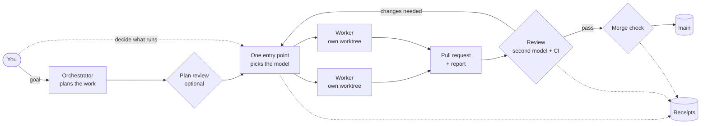

<div align="center">

# VNX Orchestration

### Let AI coding agents build. Keep the final say.

Multi-agent coding with review gates.<br/>
Claude Code and Codex build in parallel on the subscriptions you already pay for. A second model reviews each change by default. Every dispatch leaves a receipt you can read back.

[](CHANGELOG.md)
&nbsp;[](https://pypi.org/project/vnx-orchestration/)
&nbsp;[](LICENSE)
&nbsp;[](https://github.com/Vinix24/vnx-orchestration/stargazers)

**[Quickstart](#quickstart) · [How it works](#how-it-works) · [Docs](docs/) · [Blog](https://vincentvandeth.nl) · [Changelog](CHANGELOG.md)**

</div>

---

## Why VNX

<table>
<tr><td width="34%"><b>Uses the CLIs you already have</b></td><td>VNX drives <code>claude</code>, <code>codex</code>, <code>gemini</code> and <code>kimi</code> as they are. No vendor SDK. Claude Code and Codex run on the subscriptions logged in on your machine, not on per-call API credit.</td></tr>
<tr><td><b>A second opinion by default</b></td><td>Before a change merges, a second model reads the diff and CI runs. The default reviewers are Codex and DeepSeek. A high-risk change needs both to pass on the exact commit.</td></tr>
<tr><td><b>A receipt for every dispatch</b></td><td>Each dispatch leaves an append-only receipt: what was asked, which model did it and how it ended. The central ledger of my projects held 74,898 receipts on 22 November 2026.</td></tr>
<tr><td><b>Each worker gets its own branch</b></td><td>Every worker runs in its own git worktree and branch, so several can run at once. Unfinished work is kept, not wiped.</td></tr>
<tr><td><b>You decide what runs</b></td><td>A plan can be reviewed by several models before anything is built. That review is advisory by default and blocking when you switch it on. More autonomy is a per-project setting.</td></tr>
<tr><td><b>The right model per task</b></td><td>For example: Sonnet builds, Codex reviews, a local Ollama model handles private data. The model is one line in the dispatch.</td></tr>
</table>

## Works with

| CLI or model | Builds | Reviews | Billing |
|---|:---:|:---:|---|
| **Claude Code** (Opus, Sonnet) | yes | yes | your Claude subscription |
| **Codex CLI** | yes | yes, default first reviewer | your ChatGPT subscription |
| **Gemini CLI** | no, analysis only | | your Google plan or credits |
| **Kimi CLI** (K2, K3) | yes | when you pick it | your Kimi subscription |
| **DeepSeek V4 family**, inside Claude Code with your own key, or via OpenRouter | yes | yes, default second reviewer | your DeepSeek key, or OpenRouter credit |
| **GLM 5 family**, via OpenRouter | yes | when you pick it | API credit |
| **Any model on OpenRouter**, inside Claude Code or via a local proxy | yes | | OpenRouter credit |
| **Any OpenAI-compatible endpoint**, via a local proxy | yes | | your provider's credit |
| **Ollama**, local | local tasks | | free, inference stays on your machine |

Details per provider: [docs/core/PROVIDER_LANES.md](docs/core/PROVIDER_LANES.md).

## Quickstart

You need Python 3.11 to 3.13, a git repo with a GitHub remote, `gh` logged in, and a logged-in coding CLI. The example below runs on Claude Code, the default worker.

```bash
pip install vnx-orchestration
vnx init && vnx migrate     # inside your repo
vnx doctor                  # checks that a worker CLI is on your PATH
vnx dispatch-agent --agent research-analyst \
  --instruction "Summarise what this repo does in three bullets."
```

The worker runs in its own worktree and opens a pull request. It leaves a report and a receipt you can read back.

[docs/QUICKSTART.md](docs/QUICKSTART.md) shows how to read both, plus the two things that trip up a fresh project.

## How it works



1. **You set a goal.** The orchestrator breaks it into small pull requests.
2. **A plan can be reviewed** by several models before anything is built.
3. **One entry point hands out the work.** It picks the model, checks the rules, and gives each worker its own worktree.
4. **A second model reviews the result**, by default from another vendor, and CI runs. A failed review goes back as a new round.
5. **Before the merge, VNX checks** that every required reviewer passed on that exact commit. Every step writes a receipt.

The architecture in depth: [docs/core/00_VNX_ARCHITECTURE.md](docs/core/00_VNX_ARCHITECTURE.md).

## Is VNX for you?

- You already use Claude Code or Codex and want more than one session working at once.
- You want a second model to check AI-written code before it reaches `main`.
- You need to show afterwards what an agent did and which model did it, for a client or an audit.
- You want to pick the model per task, not per tool.

## What VNX is not

| | |
|---|---|
| **Not an agent SDK** | You don't write agents in Python. VNX runs the coding CLIs you already use. |
| **Not a sandbox** | Workers are isolated with git worktrees, not containers. |
| **Not a compliance certificate** | You get a local, append-only trail. Certification is still your auditor's call. |
| **Not hands-off by default** | It is built for human-gated work. You switch on more autonomy per project. |

## Status

I have used VNX every day since February 2025 to build this repo and my other products. The current release is in [`VERSION`](VERSION). What is stable, opt-in or still on paper is listed per feature in [docs/MATURITY.md](docs/MATURITY.md).

## Read more

- [Glass-box governance for multi-agent AI](https://vincentvandeth.nl/blog/glass-box-governance-multi-agent-ai)
- [The receipt ledger behind every AI decision](https://vincentvandeth.nl/blog/ndjson-receipt-ledger-ai-audit-trail)
- [Multi-model orchestration from a single terminal](https://vincentvandeth.nl/blog/multi-model-ai-orchestration-single-terminal)
- [Async quality gates for AI agent workflows](https://vincentvandeth.nl/blog/async-quality-gates-ai-agent-workflows)

All articles: [vincentvandeth.nl](https://vincentvandeth.nl). The full list is in [docs/README.md](docs/README.md#writing).

## License

MIT. Built on Anthropic's Claude Code. VNX adds the review gates, receipts, model routing and worktree isolation around it.
