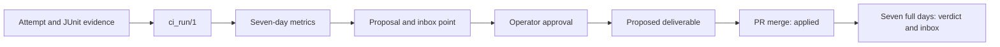

# ADR-097 - The per-project CI run record ci_run/1

## Status

**Status:** Proposed 2026-11-25 (track `ci-measurement-every-project`, M1, dispatch `dlv-0f6c01ee3691`). The two policy changes are explicit amendments in [ADR-063, Amendment 2026-11-25](ADR-063-dagelijkse-doorloopmeting.md#amendment-2026-11-25-adr-097); the earlier text remains unchanged.
**Date:** 2026-11-25
**Decision basis:** version 2 of the track plan, cleared by the plan gate on 2026-11-24 with tiebreaker START. This is the contract for the later deliverables, not evidence that their behavior is already deployed.
**Cross-refs:** ADR-026 (central project store), ADR-007 (central database keys), ADR-063 (unknown values, settled days and operator approval), ADR-074 (project impact command).

## Context

The existing daily CI duration is one aggregate per merged PR. It cannot distinguish queue time, the job determining the end of a run, retries, or repair rounds caused by red CI. The plan's 2026-11-24 observations also found only vnx-dev running the nightly measurement and five proposals with no approval or verdict. Some projects run their real gate locally, so GitHub alone cannot prove their test outcomes.

One shared record and three optional adapter keys let the framework measure every project without a project-specific collector design. The record, aggregation, thresholds, routing, approval checks and event transitions are deterministic. No model is required: timestamps, test results and linked receipts supply structured evidence. Choosing an intervention under ambiguity remains the operator's judgment; the framework does not generate or approve one with a model. Missing evidence stays unknown rather than being inferred from natural-language logs.

## Decision

### 1. Store, identity and population (M3a)

M3a introduces `ci_run/1` and its runtime file `~/.vnx-data/<project>/state/ci_runs.ndjson`: one complete NDJSON line per PR-run attempt per project. Resolve the central project store through the existing `resolve_central_data_dir(project_id)` in `scripts/lib/vnx_paths.py` (ADR-026); the new relative filename is `state/ci_runs.ndjson`. There is no central DB table, migration or database schema change. **ADR-007 therefore asks for no composite key.** Any future central table needs its own ADR-007 review.

The new record envelope carries `schema: ci_run/1`, `project_id`, repository identity, `pr_id`, `head_sha`, `run_id`, `run_attempt`, `event`, `status`, `run_started_at`, UTC day and collection time. M3a defines these record members and validates their types. Repository, project, run id and attempt identify an observation; rerunning collection must not count it twice. PR and head identity must come from evidence, never the current branch head guessed later. An unresolvable identity or population leaves collection incomplete and is named in the beacon, not silently dropped.

Include only positive evidence of `event == pull_request` and `status == completed`. Each `run_attempt` is separate, including earlier attempts of a rerun. Assign it to the UTC date of that attempt's `run_started_at`, not its completion, PR merge or collection date. `push`, `schedule` and `workflow_dispatch` do not count. Missing or unrecognised event/status data is unknown coverage, not a reason to exclude an observation. M3a must read attempt-specific timestamps and jobs; a latest-run response cannot stand in for an earlier attempt.

`VNX_CI_WORKFLOWS` selects PR-CI workflow names per project. Without the key, every workflow with a PR run counts. Pagination and the completeness of the selected attempt population must be recorded; a fixed result limit is not proof of completeness. The settled-day rule of ADR-063 §3 still applies.

### 2. Field contract and unknown reasons (M3a, M3b, M9)

Each of the six fields below has `{value, source, unknown_reason}`. `source` is mandatory even for an unavailable source: it identifies the attempted GitHub run/attempt, job or artifact read, earlier attempt references, or the mapped local gate receipt. A known value has a null reason. An unknown value is null with a reason; never zero, an empty list, success or a partial total (ADR-063 §2). Zero or an empty list requires a complete, valid observation proving it.

The following reason names are introduced by M3a/M3b/M9, not claims about existing reader behavior:

- `source_missing`: required source data is absent, empty or null, including an empty jobs read that cannot establish a start or terminal job.
- `source_invalid`: malformed data, an unknown enum, invalid timestamps, negative elapsed time, contradictory identity or incomplete pagination.
- `rate_limited`: GitHub rate limiting prevented completion; `call_budget_exhausted`: the configured nightly call ceiling prevented completion.
- `local_gate_unmapped`: M8/M9 cannot map the local gate's evidence to this field.
- `junit_not_configured`: no artifact key; `junit_artifact_missing`: a configured artifact is absent for this attempt.
- `junit_unreadable`: artifact download, XML parsing or supported result decoding failed; `junit_attempt_unverified`: the artifact cannot be tied to this attempt and head.
- `retry_history_unavailable`: earlier-attempt results needed for the retry comparison are incomplete or unreadable.

Each row enumerates all reasons allowed for that field. Multiple causes remain attributable in its source evidence; none licenses a known value without complete evidence.

| Field | Definition and `source` | Allowed `unknown_reason` values |
|---|---|---|
| `wall_seconds` | Seconds from the attempt's `run_started_at` to its `updated_at`. Source: those two timestamps from the attempt-specific GitHub run, or M9's mapped local equivalents. This is elapsed wall time, not the sum of job durations. | `source_missing`, `source_invalid`, `rate_limited`, `call_budget_exhausted`, `local_gate_unmapped` |
| `queue_seconds` | Earliest job `started_at` minus the attempt's `run_started_at`, in seconds. Source: the complete attempt job list and run start, or M9's mapped equivalents. A skipped job without a start supplies no timestamp; missing starts for other jobs leave the minimum unproven. | `source_missing`, `source_invalid`, `rate_limited`, `call_budget_exhausted`, `local_gate_unmapped` |
| `critical_path_job` | Job identity/name with the latest `completed_at` in this attempt; the longest duration (`completed_at - started_at`) breaks a tie. An exact remaining tie uses stable job id order. Exclude only jobs positively marked `skipped`. Source: complete attempt job identities, conclusions and timestamps, or M9's mapping. A missing completion is unknown, not an excluded job. | `source_missing`, `source_invalid`, `rate_limited`, `call_budget_exhausted`, `local_gate_unmapped` |
| `conclusion` | The attempt's terminal conclusion, retained as reported. Source: the attempt-specific GitHub conclusion, or a documented M9 mapping from the local gate's terminal result. It is not inferred from a nonempty response or from the absence of failures. | `source_missing`, `source_invalid`, `rate_limited`, `call_budget_exhausted`, `local_gate_unmapped` |
| `failed_tests` | Stable test ids with a failure or error in this attempt's JUnit; a sorted, deduplicated list. Source: the configured artifact for this exact attempt, including the JUnit file and testcase identity, or M9's mapped local test evidence. | `source_missing`, `source_invalid`, `junit_not_configured`, `junit_artifact_missing`, `junit_unreadable`, `junit_attempt_unverified`, `rate_limited`, `call_budget_exhausted`, `local_gate_unmapped` |
| `retry_pass_tests` | Sorted union of (1) tests that failed in an earlier attempt on the same head and explicitly passed in this attempt, and (2) tests whose JUnit explicitly records a successful rerun/flaky retry, including pytest-rerunfailures and vitest/jest retry markers. Source: current and earlier attempt JUnit references for (1), and current JUnit marker/result references for (2), or M9's mapped equivalents. | `source_missing`, `source_invalid`, `junit_not_configured`, `junit_artifact_missing`, `junit_unreadable`, `junit_attempt_unverified`, `retry_history_unavailable`, `rate_limited`, `call_budget_exhausted`, `local_gate_unmapped` |

M3b reads the artifact named by `VNX_CI_JUNIT_ARTIFACT` per attempt. It must not borrow the latest attempt's artifact. Retry comparison uses matching project, repository, workflow, head and test identity; absence from the current JUnit is not a pass. A rerun marker without a confirmed successful result is not a retry-pass. Both retry sources are checked: an incomplete union remains unknown, with any observed ids retained as evidence rather than a complete value. A first attempt needs no earlier-attempt comparison, but still needs readable current JUnit for its retry markers. Unsupported formats stay unknown.

### 3. Adapter and bounded collection

A project supplies **at most three adapter keys**, through the existing `scripts/lib/config_registry.py` configuration surface:

| Key | Contract and owner |
|---|---|
| `VNX_CI_WORKFLOWS` | Optional PR-CI workflow names; introduced by M3a. Unset means all workflows with PR runs, not no workflows. |
| `VNX_CI_JUNIT_ARTIFACT` | Optional artifact name; introduced by M3b. Unset means test fields are unknown with `junit_not_configured`. |
| `VNX_CI_IMPACT_CMD` | Existing ADR-074 impact-selection hook; its meaning and approval requirements remain unchanged. It is not required to measure CI. |

M7b documents these keys and introduces JUnit upload step templates for pytest, vitest and jest under the existing `templates/init/` directory. With no adapter, the GitHub fields and proposal framework still work; missing test evidence does not become zero failures.

M3a also introduces `VNX_CI_RECORD_MAX_CALLS`, a framework collection budget per project per night, **not a fourth adapter key**. The cap includes pagination, job reads, artifact discovery/download requests and retries by M3a/M3b; it is shared across catch-up days and cannot reset per attempt. M3a must register a finite positive default and reject invalid configuration before collection.

On a rate limit, stop further calls, write a complete unknown record for each identified skipped attempt with `rate_limited`, and write a beacon line naming the project, reason, skipped attempts and coverage. Reaching the call ceiling does the same with `call_budget_exhausted`. Never append a half record: all six field wrappers must be present and validated before a line is written. If discovery stopped before all attempt identities were known, report the population as incomplete in the beacon; do not invent attempts or publish the enumerated subset as the total. Ordinary absent JUnit may coexist with known timing fields in a complete record.

M8 inventories local gate evidence in seocrawler-v2 and mission-control. M9 maps it into the same record and field semantics, or emits `local_gate_unmapped` per unavailable field. A missing local log is not evidence of green CI, and a GitHub run is not silently substituted for the real local gate.

### 4. Metrics, attribution and proposals (M4a, M4b)

M4a derives the following metric families from the attempt records with a baseline of **seven full UTC days**, preserving source references, population, sample size and unknown coverage:

| Metric family | Population and definition |
|---|---|
| Wall time | Median and p90 of `wall_seconds` over green first attempts: explicit `conclusion == success` and `run_attempt == 1`. |
| Critical-path frequency | The job most often selected as `critical_path_job` and its share of completed PR attempts. |
| Red share | Red attempts divided by completed PR attempts. Positive conclusions `failure` and `timed_out` establish red; `success` establishes green. Other recognised terminal outcomes remain separately visible; missing/unrecognised conclusions cannot establish either. |
| Retry-pass share | Attempts with at least one confirmed `retry_pass_tests` id divided by completed PR attempts. Unknown test lists are not empty lists. |
| CI-red repair rounds per merged PR | Linked CI-red repair dispatches for the day's merged PR population, divided by its merged PR count. Unknown attribution remains visible, not counted as a CI repair or as zero repairs. |

An empty or incompletely evidenced denominator gives unknown with a reason. Unknown fields needed for a metric prevent publishing a partial value as the whole population's value. These are new attempt-based measurements; M4a must not silently relabel ADR-063's existing `ci_duration_seconds_median`, whose population is merged PRs, as an attempt metric. Their versioned definitions and baseline must remain distinguishable.

A **CI-red repair round** is exactly a dispatch `<dlv>-rN` fired after a head whose PR-CI was red and on which **no review seat gave FAIL**. Link it through `pr_id` and the head SHA in the receipt, within the same project/repository, and prove the fire followed that head's result. Complete, valid review-seat evidence is needed to establish that no seat gave FAIL; an empty read, missing seat result or unknown verdict does not prove this. A positive review FAIL prevents CI-only attribution. A round without a linkable head counts as **unknown**, never as CI. Each linked repair dispatch counts once; a workflow rerun alone is not a repair dispatch.

M4b extends the existing `scripts/lib/daily_metrics/proposal_rules.py` with deterministic rules for these metrics: at most **three proposals per project per day**, sharing the existing daily cap, and none without a baseline of seven full days. Each proposal names the metric, value against baseline, expected effect, target track and a deliverable that can be created as `proposed`. ADR-063's amended flow governs notification, approval, application and verdict.

### 5. Implementation boundaries

- **M3a/M3b:** writer and JUnit reader in the existing `scripts/lib/daily_metrics/sources/` and `scripts/lib/daily_metrics/github_fetch.py`; all new record fields, reason codes and keys above belong to these deliverables (local mapping to M9).
- **M4a/M4b:** aggregation and proposal rules in the existing `scripts/lib/daily_metrics/sources/ci.py`, `scripts/lib/daily_metrics/baseline.py` and `scripts/lib/daily_metrics/proposal_rules.py`.
- **M5a/M5b/M5c:** approval protection, inbox lifecycle and deliverable creation, then the new `applied` event and verdict timing. The exact policy is the linked ADR-063 amendment.
- **M6/M7a:** per-project freshness beacon, then required nightly family and initialization. **M2** owns rollout through operating; **M10** owns seven-day freshness evidence for every registered project. No rollout or runtime-state mutation occurs in M1.

## Consequences

- A portable, deterministic contract separates collection from project configuration and operator judgment. No model-backed component or model failure path is needed; validation, unknown reasons and receipts carry the audit evidence.
- Per-attempt job and artifact reads cost more GitHub calls. The cap makes cost bounded and coverage explicit; reaching it can delay a usable baseline and proposals.
- Missing JUnit or unmapped local logs may leave test metrics unknown for an entire project. That loss of coverage is accepted over inventing test outcomes; M8 determines whether M9 can close it.
- Required nightly measurement changes ADR-063's opt-in policy, while approval remains an operator action. Verdicts measure the applied change against the baseline frozen at approval, so a slow implementation cannot consume its observation window.
- NDJSON adds no central database migration. Implementation and rollout remain separate, reviewable deliverables; the existing ADR-063 text is preserved and superseded only where the amendment says so.

## What this ADR does not do

It implements no writer, parser, metric, inbox handler, job installation or local gate adapter. It changes no CI selection or merge policy, approves no intervention and loads no launchd job. It does not claim every project already has a seven-day baseline. M3a through M10 own those results and their tests; this documentation deliverable fixes their interfaces and the two explicit policy amendments.
